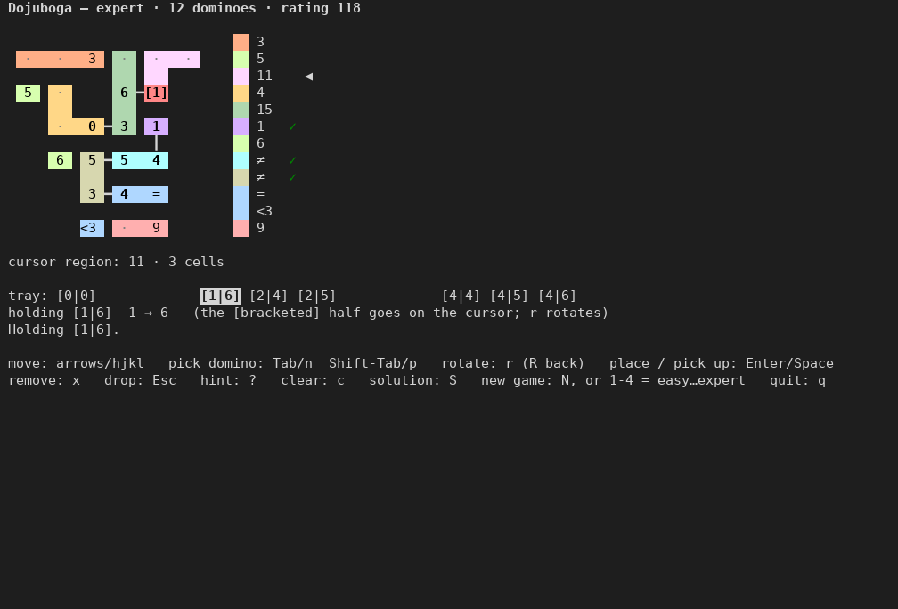

# Dojuboga

*Dojuboga* (pronounced "doh-joo-BOH-gah": **do**minoes + **Ju**lia + **bo**ard **ga**me) is a
terminal domino-placement puzzle in the style of the NYT *Pips*. You get an
irregular board split into coloured regions, each with a rule (`7`, `<4`, `>9`,
`=`, `≠` or blank), and a set of distinct dominoes to place so that every rule
holds. Every puzzle has a **unique solution** and a **rated difficulty**: easy,
medium, hard or expert.

It is pure Julia with standard-library dependencies only. It runs in any
256-colour terminal, including over ssh, tmux and screen.



## Install

Requires Julia 1.9 or later. Dojuboga is registered in the
[LEFT_registry](https://github.com/cjwinstead/LEFT_registry):

```julia
pkg> registry add https://github.com/cjwinstead/LEFT_registry
pkg> add Dojuboga
```

## Play

From the Julia REPL:

```julia
using Dojuboga
play_terminal()                 # medium
play_terminal(:expert)          # :easy | :medium | :hard | :expert
play_terminal(:hard; seed = 42) # reproducible puzzle
```

From the shell, once installed:

```bash
julia -e 'using Dojuboga; exit(Dojuboga.main(ARGS))' hard
```

Or from a clone of this repository:

```bash
cd Dojuboga.jl
julia --project=. play.jl                # medium
julia --project=. play.jl expert 42      # level and optional seed
NO_COLOR=1 julia --project=. play.jl     # plain text: regions shown as letters
```

The first start takes a few seconds while Julia compiles the package. Set
`NO_COLOR=1` (or pass `color = false`) for terminals without 256 colours.

| Key | Action |
|---|---|
| arrows or `h j k l` | move the cursor (it can cross holes, so every cell is reachable) |
| `Tab`/`n`, `Shift-Tab`/`p` | take the next / previous domino from the tray |
| `r` / `R` | turn the held domino clockwise / back |
| `Enter` or `Space` | place it (the `[bracketed]` half goes on the cursor); with nothing held, pick up the domino under the cursor |
| `x`, `Backspace`, `Delete` | send the domino under the cursor back to the tray |
| `Esc` | put the held domino back |
| `?` / `c` / `S` | hint / clear the board / show the solution |
| `N`, or `1`–`4` | new game (same level, or easy … expert) |
| `q` | quit |

Each rule is shown in its region's bottom-right cell and in the legend on the
right, which marks a full region ✓ or ✗. The held domino appears as a ghost at
the cursor: green if it fits, red if not.

## Project

```
play.jl                   terminal launcher
src/Dojuboga.jl           module: exports the engine, the front-end API and play_terminal
src/engine/               generator, exact solver, difficulty rater (see SPEC.md)
src/game.jl               front-end API: Game, queries, actions, events (see API.md)
src/terminal/Terminal.jl  the terminal game, built on the API only
examples/                 makie_frontend.jl (GUI add-on starting point), print_puzzle.jl
test/runtests.jl          tests
SPEC.md                   how boards are generated and difficulty is measured
API.md                    how to write a front end / GUI add-on
```

## Using the engine directly

```julia
using Dojuboga
p = generate(:hard; seed = 7)   # Puzzle: instance, reference solution, rating
display(p); show_solution(p)
is_unique(p.inst)               # true
g = Game(p)                     # play it through the front-end API
```

## Tests

```bash
julia --project=. -e 'using Pkg; Pkg.test()'
```

The tests generate puzzles at every level and check them for uniqueness,
distinct dominoes, connected regions, the target difficulty and determinism.
They exercise the whole front-end API, including events, refused moves and
wrong full boards, and they solve puzzles through the terminal UI using
keystrokes alone.

## License

MIT — see [LICENSE](LICENSE).

## Acknowledgements

The puzzle format is inspired by *Pips* from The New York Times Games.
Dojuboga is an independent project, not affiliated with or endorsed by
The New York Times.
